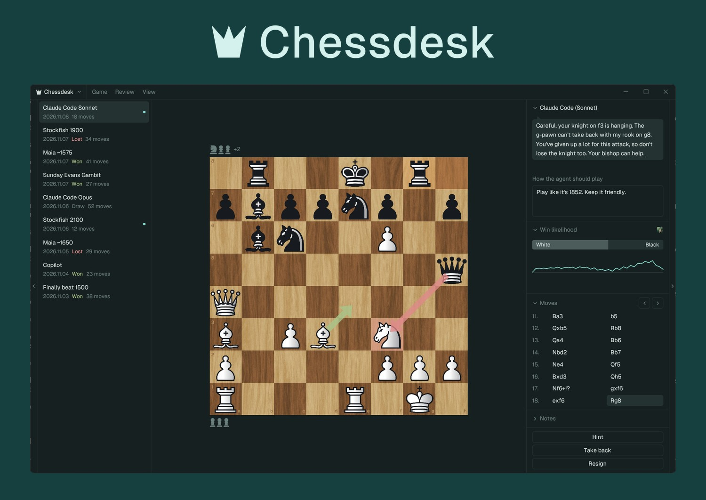
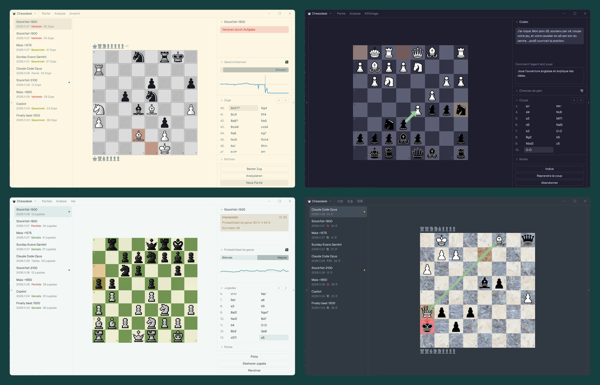

  <picture>
    <source media="(prefers-color-scheme: light)" srcset="docs/screenshot-light.jpg">
    
  </picture>

<b>Play chess against Claude Code, Codex and the other AI agents you already use.</b> 
Or against Stockfish and Maia. Free, open source, on your own machine.

**Chessdesk** is a desktop chess app for playing the AI agents you already use: Claude Code, Codex,
Copilot, OpenCode and Pi. They play you, and if you want, they talk you through the game: what they
think of your last move, what they're planning, and where you're about to lose a piece, with arrows
on the board.

An engine only gives you moves and numbers. An agent tells you why, in your language, and plays the
way you ask it to. Chessdesk runs the rules, the clock and the analysis itself, so the agent only
does what it's good at, and a game costs few tokens. Your games stay on your machine as plain PGN
files.

## What you can do

**Play the agents you already use.** Claude Code, Codex, Copilot, OpenCode and Pi play on your own
account. Pick any model the agent offers and how hard it thinks, and tell it how to play in your own
words: "Open with the London System", "Go easy on me", "Play like it's 1852".

**Or play an engine.** Stockfish goes from about 1320 engine Elo up to full strength. Maia is
trained on human games, so it makes human mistakes.

**Learn while you play.** Turn on tutoring mode and the agent comments as you go, or Stockfish rates
each of your moves against an engine. Hint shows you a good move when you're stuck, and it costs no
tokens.

**Go back over your games.** Every game is saved as you play. Open one from the sidebar and press
Analyze: an agent goes through your moves one by one and explains them, or Stockfish checks each
move and marks your mistakes. The bar and graph show how the game swung. Notes you write next to a
game are saved in its PGN file, and agents never see them.

**Keep several games going.** Start another game and the first one keeps running, clocks included.
A dot marks the unfinished ones, and you can drop back in even after a restart.

**Make it yours.** There are piece sets, boards, colour themes and sounds to choose from, and it
speaks English, German, French, Spanish, Hindi and Chinese. It picks up your system's language by
itself, and the first start shows the main choices on a preview board. Adding your own set or
language means copying a folder, see [docs/plugins.md](docs/plugins.md).

<i>A game gone over in German, on Solarized Light with the Newspaper board · Codex in
French, on Catppuccin Mocha with Chessnut pieces · tutoring in Spanish, with Pixel pieces on Green ·
Claude Code in Chinese, on Mariana with Marble</i>

## Download

Get it from [Releases](https://github.com/chessdesk/chessdesk/releases): a zip for Windows, a
universal app for macOS and a tarball for Linux. Each is a single program with nothing to install,
and it updates itself: when a new release is out, an Update button in the title bar fetches it, and
it runs from the next start. Or [build it yourself](docs/development.md).

It's been played on Windows so far. The macOS and Linux builds are started on those systems before
every release, but nobody has played on them yet, so reports are welcome.

The builds aren't signed, so your system asks before the first start:

- **Windows**: SmartScreen says it protected your PC. Click More info, then Run anyway.
- **macOS**: open Chessdesk once, then System Settings, Privacy & Security, Open Anyway. Or run
  `xattr -dr com.apple.quarantine Chessdesk.app`.
- **Linux**: needs a Vulkan driver (`mesa-vulkan-drivers` on Debian and Ubuntu).

## Setting up opponents

Everything is under Settings (`Ctrl+,`), and the new game dialog tells you if something's missing.

| Opponent | What you need |
|---|---|
| Claude Code, Codex | [Node.js](https://nodejs.org) and your login, then install the adapter under Settings, Agents |
| Copilot | The [Copilot CLI](https://github.com/github/copilot-cli) and your login |
| OpenCode | [OpenCode](https://opencode.ai), set up with a provider |
| Pi | [Pi](https://github.com/earendil-works/pi), set up with a provider, Node.js, and the adapter |
| Stockfish | Nothing: one click in New Game, or under Settings, Engines |
| Maia | Nothing on Windows: download it under Settings, Engines. Elsewhere, install [lc0](https://lczero.org) yourself |

## What agents cost

Agents use your own account, so moves cost tokens. Chessdesk tries hard to keep that small: the rules,
the clock and the analysis all run on your machine, and an agent only gets the last move and the
position. A move is about 1,000 tokens on Claude, most of it cached, and reviewing a short game about
2,000. You can set a token budget for a game, which pauses it when it's used up. Hover over the
opponent's name to see what a game has used so far.

If an agent can't come up with a legal move, it gets one more try with the legal moves spelled out.
After that the game pauses and you decide. Chessdesk never makes up a move for it.

## Keys

| Key | What it does |
|---|---|
| `Ctrl+N` | New game |
| `Ctrl+O`, `Ctrl+S` | Open or save a PGN |
| `Ctrl+E` | Export a game |
| `Ctrl+F` | Flip the board |
| `Ctrl+Z` | Take back |
| `Left`, `Right`, `Home`, `End` | Step through the moves |
| `Ctrl+B`, `Ctrl+Shift+B` | Show or hide the game history and the game panel |
| `Ctrl+,` | Settings |

## Licence

Copyright © 2026 Moritz Maibaum. Chessdesk is free software under the GNU General Public License,
version 3 or later: see [`LICENSE`](LICENSE). The plugins have their own licences, listed in
[docs/plugins.md](docs/plugins.md). How agents are kept cheap is measured in
[docs/design.md](docs/design.md).
